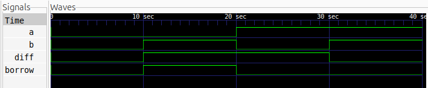

# Half Subtractor

## Description

A Half Subtractor is a combinational logic circuit that subtracts one
1-bit binary number (B) from another (A), producing Difference and Borrow outputs.

## Logic

- Difference = A ^ B
- Borrow = ~A & B

### Truth Table

| A | B | Diff | Borrow |
|---|---|------|--------|
| 0 | 0 | 0    | 0      |
| 0 | 1 | 1    | 1      |
| 1 | 0 | 1    | 0      |
| 1 | 1 | 0    | 0      |

## Files

- `half_sub.v` — Verilog design
- `half_sub_tb.v` — Testbench

## Simulation Waveform



## Tools

- Verilog HDL
- Icarus Verilog
- GTKWave

## Simulation

### Compile

```bash
iverilog -o half_sub_sim half_sub.v half_sub_tb.v
```

### Run

```bash
vvp half_sub_sim
```

### View Waveform

```bash
gtkwave half_sub.vcd
```
