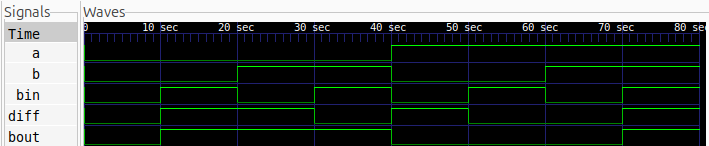

# Full Subtractor

## Description

A Full Subtractor is a combinational logic circuit that subtracts two
1-bit binary numbers while considering an input borrow.

## Logic

- Difference = A ^ B ^ Bin
- Borrow = (~A & B) | (~A & Bin) | (B & Bin)

### Truth Table

| A | B | Bin | Diff | Bout |
|---|---|-----|------|------|
| 0 | 0 | 0   | 0    | 0    |
| 0 | 0 | 1   | 1    | 1    |
| 0 | 1 | 0   | 1    | 1    |
| 0 | 1 | 1   | 0    | 1    |
| 1 | 0 | 0   | 1    | 0    |
| 1 | 0 | 1   | 0    | 0    |
| 1 | 1 | 0   | 0    | 0    |
| 1 | 1 | 1   | 1    | 1    |

## Files

- `full_subtractor.v` — Verilog design
- `full_subtractor_tb.v` — Testbench

## Simulation Waveform



## Tools

- Verilog HDL
- Icarus Verilog
- GTKWave

## Simulation

### Compile

```bash
iverilog -o full_subtractor_sim full_subtractor.v full_subtractor_tb.v
```

### Run

```bash
vvp full_subtractor_sim
```

### View Waveform

```bash
gtkwave full_subtractor.vcd
```
