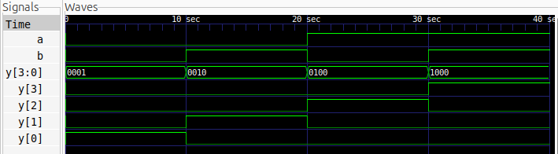

# 2-to-4 Decoder

## Description

A 2-to-4 decoder is a combinational logic circuit that converts
a 2-bit binary input into one of four active-high outputs.
Exactly one output is HIGH for each valid input combination.

## Logic

| A | B | Y3 | Y2 | Y1 | Y0 |
|---|---|----|----|----|----|
| 0 | 0 | 0  | 0  | 0  | 1  |
| 0 | 1 | 0  | 0  | 1  | 0  |
| 1 | 0 | 0  | 1  | 0  | 0  |
| 1 | 1 | 1  | 0  | 0  | 0  |

## Files

- `decoder_2to4.v` — Verilog design
- `decoder_2to4_tb.v` — Testbench

## Simulation Waveform



## Tools

- Verilog HDL
- Icarus Verilog
- GTKWave

## Simulation

### Compile

```bash
iverilog -o decoder_2to4_sim decoder_2to4.v decoder_2to4_tb.v
```

### Run

```bash
vvp decoder_2to4_sim
```

### View Waveform

```bash
gtkwave decoder_2to4.vcd
```
