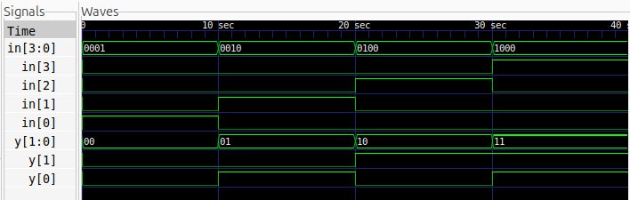

# 4-to-2 Encoder

## Description
A 4-to-2 Encoder is a combinational logic circuit that converts four input lines into a 2-bit binary output. It assumes that only one input is HIGH at a time.

## Logic
The encoder produces a 2-bit output corresponding to the active input.

Boolean expressions:
- Y[1] = D[3] | D[2]
- Y[0] = D[3] | D[1]

### Truth Table

| D3 | D2 | D1 | D0 | Y1 | Y0 |
|----|----|----|----|----|----|
| 0  | 0  | 0  | 1  | 0  | 0  |
| 0  | 0  | 1  | 0  | 0  | 1  |
| 0  | 1  | 0  | 0  | 1  | 0  |
| 1  | 0  | 0  | 0  | 1  | 1  |

## Files
- `encoder_4to2.v` – Verilog design
- `encoder_4to2_tb.v` – Testbench
- `waveform.png` – Simulation waveform

## Logic Schematic


## Simulation Waveform



## Tools
- Verilog HDL
- Icarus Verilog
- GTKWave

## Simulation

### Compile
```bash
iverilog -o encoder_4to2_sim encoder_4to2.v encoder_4to2_tb.v
```

### Run
```bash
vvp encoder_4to2_sim
```

### View Waveform
```bash
gtkwave encoder_4to2.vcd
```
