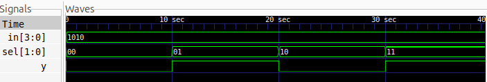

# 4:1 Multiplexer

## Description
A 4:1 Multiplexer is a combinational logic circuit that selects one of four input signals and forwards it to a single output based on two select lines. This design is implemented using gate-level modelling in Verilog with NOT, AND, and OR gates.

## Logic
The output depends on the values of the two select lines.

Boolean expression:

Y = (~S1 & ~S0 & D0) | (~S1 & S0 & D1) | (S1 & ~S0 & D2) | (S1 & S0 & D3)

### Truth Table

| S1 | S0 | Selected Input | Output |
|----|----|----------------|--------|
| 0  | 0  | D0             | D0     |
| 0  | 1  | D1             | D1     |
| 1  | 0  | D2             | D2     |
| 1  | 1  | D3             | D3     |

## Files
- `mux4to1.v` – Gate-level Verilog design
- `mux4to1_tb.v` – Testbench
- `waveform.png` – Simulation waveform
- `mux4to1.svg` – Logic schematic generated using Yosys and netlistsvg

## Logic Schematic


## Simulation Waveform



## Tools
- Verilog HDL
- Icarus Verilog
- GTKWave
- Yosys
- netlistsvg

## Simulation

### Compile
```bash
iverilog -o mux4to1_sim mux4to1.v mux4to1_tb.v
```

### Run
```bash
vvp mux4to1_sim
```

### View Waveform
```bash
gtkwave mux4to1.vcd
```
