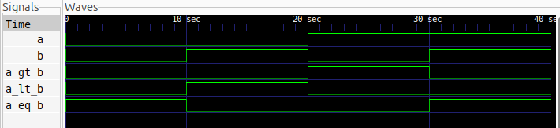

# 1-Bit Comparator

## Description

A 1-bit comparator is a combinational circuit that compares two single-bit binary inputs, `A` and `B`. It determines whether A is greater than B, A is less than B, or A is equal to B.

The circuit is designed using Verilog HDL and simulated using Icarus Verilog. The simulation waveforms are viewed using GTKWave.

## Logic

The comparator has two inputs (`A`, `B`) and three outputs:

- `A_gt_B`: HIGH when A > B.
- `A_lt_B`: HIGH when A < B.
- `A_eq_B`: HIGH when A = B.

### Truth Table

| A | B | A_gt_B | A_lt_B | A_eq_B |
|:-:|:-:|:------:|:------:|:------:|
| 0 | 0 | 0 | 0 | 1 |
| 0 | 1 | 0 | 1 | 0 |
| 1 | 0 | 1 | 0 | 0 |
| 1 | 1 | 0 | 0 | 1 |

### Boolean Expressions

- `A_gt_B = A & ~B`
- `A_lt_B = ~A & B`
- `A_eq_B =  A ~^ B`

## Files

- `comparator1bit.v` — Verilog design file.
- `comparator1bit_tb.v` — Testbench file.
- `waveform.png` — Simulation waveform captured using GTKWave.
- `comparator1bit.svg` - Schematic image

## Schematic Diagram


## Simulation Waveform



## Tools

- Verilog HDL
- Icarus Verilog
- GTKWave

## Simulation

**Compile the design and testbench:**

```bash
iverilog -o comparator1bit_sim comparator1bit.v comparator1bit_tb.v
```

**Run the simulation:**

```bash
vvp comparator1bit_sim
```

**View the waveform:**

```bash
gtkwave comparator1bit.vcd
```
