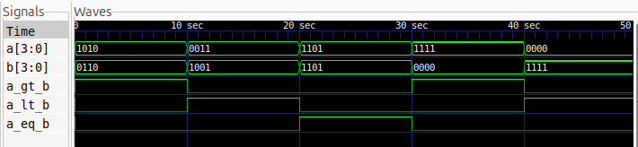

# 4-Bit Magnitude Comparator

## Description

A 4-bit magnitude comparator is a combinational circuit that compares two 4-bit binary numbers, `A` and `B`, to determine whether A is greater than, less than, or equal to B.

This project implements a 4-bit comparator using **gate-level modelling in Verilog HDL**. The design uses XNOR, NOT, AND, and OR gates. The circuit is simulated using Icarus Verilog, and the output waveforms are viewed using GTKWave.

## Logic

The comparator has two 4-bit inputs (`A[3:0]`, `B[3:0]`) and three outputs:

- `A_gt_B`: HIGH when A is greater than B.
- `A_lt_B`: HIGH when A is less than B.
- `A_eq_B`: HIGH when A is equal to B.

### Boolean Expressions

First, define the equality terms using XNOR gates:

\[
E_i = A_i \odot B_i,\quad i=0,1,2,3
\]

Here, \(\odot\) represents the XNOR operation.

**1. Greater Than (A > B)**

\[
\begin{aligned}
A\_gt\_B ={}& A_3\overline{B_3}\\
&+ E_3 A_2\overline{B_2}\\
&+ E_3E_2 A_1\overline{B_1}\\
&+ E_3E_2E_1 A_0\overline{B_0}
\end{aligned}
\]

**2. Less Than (A < B)**

\[
\begin{aligned}
A\_lt\_B ={}& \overline{A_3}B_3\\
&+ E_3\overline{A_2}B_2\\
&+ E_3E_2\overline{A_1}B_1\\
&+ E_3E_2E_1\overline{A_0}B_0
\end{aligned}
\]

**3. Equal To (A = B)**

\[
A\_eq\_B = E_3E_2E_1E_0
\]

Here, \(+\) represents OR, multiplication represents AND, and the overbar represents NOT.

### Gate-Level Implementation

The design uses the following logic gates:

- **XNOR gates:** Compare corresponding bits of A and B.
- **NOT gates:** Generate complemented input bits.
- **AND gates:** Implement the individual greater-than and less-than conditions.
- **OR gates:** Combine the comparison terms to generate the final outputs.

## Files

- `comparator4bit.v` — Gate-level Verilog design.
- `comparator4bit_tb.v` — Testbench for verifying the comparator.
- `waveform.png` — Simulation waveform captured using GTKWave.
- `comparator4bit.svg` - Schematic Diagram

## Logic Schematic


## Simulation Waveform



## Tools

- Verilog HDL
- Icarus Verilog
- GTKWave

## Simulation

**Compile the design and testbench:**

```bash
iverilog -o comparator4bit_sim comparator4bit.v comparator4bit_tb.v
```

**Run the simulation:**

```bash
vvp comparator4bit_sim
```

**View the waveform:**

```bash
gtkwave comparator4bit.vcd
```
