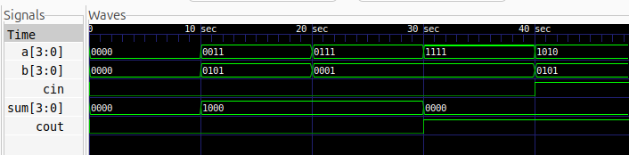

# 4-bit Ripple Carry Adder in Verilog

## Description

A 4-bit Ripple Carry Adder is a combinational logic circuit that adds two 4-bit binary numbers along with an input carry. It is constructed by connecting four 1-bit Full Adders in series.

The carry output of each Full Adder is connected to the carry input of the next stage. The carry propagates from the least significant bit (LSB) to the most significant bit (MSB), giving the circuit its name.

This project implements a 4-bit Ripple Carry Adder using **structural modelling in Verilog HDL**.

## Logic

The circuit takes two 4-bit inputs, `a` and `b`, and a carry input, `cin`. It produces a 4-bit sum, `sum`, and a final carry output, `cout`.

The addition is expressed as:

\[
\{cout, sum\} = a + b + cin
\]

Each Full Adder calculates its sum and carry outputs using:

- **Sum:** `sum = a ^ b ^ cin`
- **Carry:** `cout = (a & b) | (b & cin) | (a & cin)`

### Carry Propagation

| Full Adder | Inputs | Sum Output | Carry Output |
|---|---|---|---|
| FA0 | `a[0]`, `b[0]`, `cin` | `sum[0]` | `w1` |
| FA1 | `a[1]`, `b[1]`, `w1` | `sum[1]` | `w2` |
| FA2 | `a[2]`, `b[2]`, `w2` | `sum[2]` | `w3` |
| FA3 | `a[3]`, `b[3]`, `w3` | `sum[3]` | `cout` |

## Files

- `full_adder.v` — Verilog implementation of a 1-bit Full Adder using an `always` block.
- `ripple_carry_adder.v` — Top-level design connecting four Full Adders.
- `ripple_carry_adder_tb.v` — Testbench for functional verification.
- `ripple_carry_adder.vcd` — Simulation waveform data.
- `waveform.png` — GTKWave simulation screenshot.
- `ripple_carry_adder.svg` — Flattened logic schematic generated using Yosys and netlistsvg.
- `ripple_carry_adder_blocks.svg` — Structural schematic showing the Full Adder modules, if preserved by the chosen synthesis flow.

## Schematic

### Flattened Logic Schematic

The following schematic illustrates the synthesized logic of the Ripple Carry Adder after flattening the Full Adder modules.


### Structural Schematic

The structural view represents the Ripple Carry Adder at the module level, illustrating the Full Adder instances and their connections.


## Simulation Waveform

The design can be simulated using Icarus Verilog, with the generated waveform viewed in GTKWave.



## Example Results

| A | B | Cin | Cout | Sum | Decimal Addition |
|---|---|---|---|---|---|
| `0000` | `0000` | 0 | 0 | `0000` | 0 + 0 = 0 |
| `0011` | `0101` | 0 | 0 | `1000` | 3 + 5 = 8 |
| `0111` | `0001` | 0 | 0 | `1000` | 7 + 1 = 8 |
| `1111` | `0001` | 0 | 1 | `0000` | 15 + 1 = 16 |
| `1010` | `0101` | 1 | 1 | `0000` | 10 + 5 + 1 = 16 |

## Tools

- Verilog HDL
- Icarus Verilog
- GTKWave
- Yosys
- netlistsvg

## Simulation

### Compile

```bash
iverilog -o ripple_carry_adder_sim full_adder.v ripple_carry_adder.v ripple_carry_adder_tb.v
```

### Run the Simulation

```bash
vvp ripple_carry_adder_sim
```

### View the Waveform

```bash
gtkwave ripple_carry_adder.vcd
```

## Generate the Schematic

### Flattened Logic Schematic

```bash
yosys -p "read_verilog full_adder.v ripple_carry_adder.v; prep -top ripple_carry_adder -flatten; write_json ripple_carry_adder.json"
netlistsvg ripple_carry_adder.json -o ripple_carry_adder.svg
```

### Structural Schematic

```bash
yosys -p "read_verilog full_adder.v ripple_carry_adder.v; prep -top ripple_carry_adder; write_json ripple_carry_adder_blocks.json"
netlistsvg ripple_carry_adder_blocks.json -o ripple_carry_adder_blocks.svg
```
