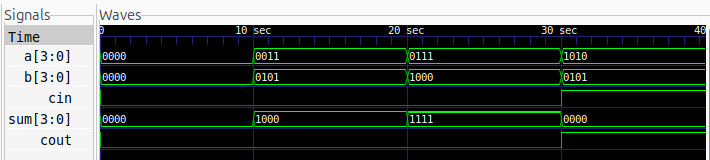

# 4-bit Carry Look-Ahead Adder

## Description

A 4-bit Carry Look-Ahead Adder (CLA) is a combinational circuit that adds two 4-bit binary numbers along with an input carry (`cin`). Unlike a Ripple Carry Adder (RCA), which propagates the carry sequentially from one bit to the next, a CLA calculates the carry signals using **Generate** and **Propagate** logic to reduce carry propagation delay.

## Logic

The adder uses the following signals:

- **Generate:** `G[i] = A[i] & B[i]`
- **Propagate:** `P[i] = A[i] ^ B[i]`

The carry equations are expanded to calculate the carries directly:

- `C1 = G0 | (P0 & cin)`
- `C2 = G1 | (P1 & G0) | (P1 & P0 & cin)`
- `C3 = G2 | (P2 & G1) | (P2 & P1 & G0) | (P2 & P1 & P0 & cin)`
- `C4 = G3 | (P3 & G2) | (P3 & P2 & G1) | (P3 & P2 & P1 & G0) | (P3 & P2 & P1 & P0 & cin)`

The sum bits are calculated as:

- `S0 = P0 ^ cin`
- `S1 = P1 ^ C1`
- `S2 = P2 ^ C2`
- `S3 = P3 ^ C3`

The final carry-out is `C4`.

## Files

- `carry_lookahead_adder.v` — Verilog implementation of the 4-bit CLA.
- `carry_lookahead_adder_tb.v` — Testbench for functional verification.
- `waveform.png` — Simulation waveform generated by Icarus Verilog.
- `carry_lookahead_adder.svg` — Logic schematic generated using Yosys and netlistsvg.

## Schematic


## Simulation Waveform



## Tools

- Verilog HDL
- Icarus Verilog
- GTKWave
- Yosys
- netlistsvg

## Simulation

### 1. Compile the Verilog files

```bash
iverilog -o cla_sim carry_lookahead_adder.v carry_lookahead_adder_tb.v
```

### 2. Run the simulation

```bash
vvp cla_sim
```

### 3. Open the waveform

```bash
gtkwave waveform.vcd
```
