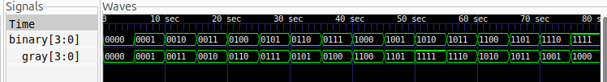

# 4-Bit Binary-to-Gray Code Converter

## Description
This project implements a 4-bit Binary-to-Gray Code Converter using Verilog HDL. It converts a 4-bit binary input into its corresponding 4-bit Gray code representation using combinational logic.

Gray code is a binary numeral system in which two consecutive values differ by exactly one bit. It is commonly used in rotary encoders, position sensors, and digital systems to minimize errors during transitions between consecutive values.

## Logic
The most significant Gray code bit is identical to the most significant binary bit. Each remaining Gray code bit is obtained by XORing two adjacent binary bits.

The Boolean expressions are:

- `G[3] = B[3]`
- `G[2] = B[3] ^ B[2]`
- `G[1] = B[2] ^ B[1]`
- `G[0] = B[1] ^ B[0]`

## Truth Table

| Decimal | Binary Input | Gray Output |
|--------:|:------------:|:-----------:|
| 0  | 0000 | 0000 |
| 1  | 0001 | 0001 |
| 2  | 0010 | 0011 |
| 3  | 0011 | 0010 |
| 4  | 0100 | 0110 |
| 5  | 0101 | 0111 |
| 6  | 0110 | 0101 |
| 7  | 0111 | 0100 |
| 8  | 1000 | 1100 |
| 9  | 1001 | 1101 |
| 10 | 1010 | 1111 |
| 11 | 1011 | 1110 |
| 12 | 1100 | 1010 |
| 13 | 1101 | 1011 |
| 14 | 1110 | 1001 |
| 15 | 1111 | 1000 |

## Logic Schematic

The synthesized circuit consists of three XOR gates and one direct connection.


## Files
- `binary_to_gray.v` — Verilog design implementation.
- `binary_to_gray_tb.v` — Testbench for verifying all 16 input combinations.
- `binary_to_gray.vcd` — Simulation waveform data.
- `binary_to_gray.svg` — Synthesized logic schematic.
- `waveform.png` — Simulation waveform screenshot.

## Simulation Waveform

The waveform verifies the conversion of all 16 possible binary inputs into their corresponding Gray code outputs.



## Tools
- Verilog HDL
- Icarus Verilog
- GTKWave
- Yosys
- netlistsvg

## Simulation

Compile the design and testbench:

```bash
iverilog -o binary_to_gray_sim binary_to_gray.v binary_to_gray_tb.v
```

Run the simulation:

```bash
vvp binary_to_gray_sim
```

Open the waveform:

```bash
gtkwave binary_to_gray.vcd
```

## Schematic Generation

Generate the JSON netlist using Yosys:

```bash
yosys -p "read_verilog binary_to_gray.v; hierarchy -top binary_to_gray; proc; opt; check; write_json binary_to_gray.json"
```

Convert the JSON netlist into an SVG schematic:

```bash
netlistsvg binary_to_gray.json -o binary_to_gray.svg
```
