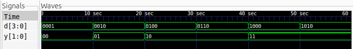

# 4-to-2 Priority Encoder

## Description
A 4-to-2 Priority Encoder is a combinational logic circuit that converts four input lines into a 2-bit binary output. When multiple inputs are HIGH simultaneously, the encoder selects the input with the highest priority.

In this design, the priority order is **D3 > D2 > D1 > D0**, with D3 having the highest priority. The design uses `casex` statements in Verilog to implement the priority logic.

## Logic

The priority encoder uses the following input patterns:

| Input Pattern | Output Y | Selected Input |
|:---:|:---:|:---:|
| `1xxx` | `11` | D3 |
| `01xx` | `10` | D2 |
| `001x` | `01` | D1 |
| `0001` | `00` | D0 |

Here, `x` represents a wildcard that can match either `0` or `1`. Higher-priority inputs take precedence over lower-priority inputs.

## Schematic

The synthesized schematic illustrates the logic implementing the priority encoder.


## Files
- `priority_encoder_4to2.v` – Verilog design implementing the priority encoder.
- `priority_encoder_4to2_tb.v` – Testbench for verifying all 16 input combinations.
- `priority_encoder.vcd` – Simulation waveform data.
- `priority_encoder.svg` – Synthesized logic schematic generated using Yosys and netlistsvg.
- `waveform.png` – Screenshot of the simulation waveform.

## Simulation Waveform

The waveform demonstrates the encoder's response to all 16 input combinations, showing the input vector `d` and encoded output `y`.



## Tools
- Verilog HDL
- Icarus Verilog
- GTKWave
- Yosys
- netlistsvg

## Simulation

Compile the design and testbench:

```bash
iverilog -o priority_encoder_sim priority_encoder_4to2.v priority_encoder_4to2_tb.v
```

Run the simulation:

```bash
vvp priority_encoder_sim
```

Open the waveform:

```bash
gtkwave priority_encoder.vcd
```
