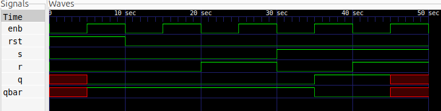

# SR Latch with Enable and Synchronous Reset

## Description
This project implements a level-sensitive SR (Set-Reset) Latch using Verilog HDL. The design uses case-based modeling with an Enable input and a synchronous Reset. The latch stores one bit of information and retains its previous state when Enable is LOW or when both Set and Reset are LOW.

## Logic
The latch operates according to the following conditions:

- **Enable (`enb`) = 0:** Holds the previous state.
- **Reset (`rst`) = 1:** Resets the outputs when Enable is HIGH.
- **Set (`s`) = 1, Reset input (`r`) = 0:** Sets `q` to HIGH.
- **Set (`s`) = 0, Reset input (`r`) = 1:** Resets `q` to LOW.
- **Set (`s`) = 0, Reset input (`r`) = 0:** Holds the previous state.
- **Set (`s`) = 1, Reset input (`r`) = 1:** Forbidden state.

### Truth Table

| enb | rst | s | r | q(next) | Operation |
|:---:|:---:|:---:|:---:|:---:|---|
| 0 | X | X | X | q(previous) | Hold |
| 1 | 1 | X | X | 0 | Synchronous Reset |
| 1 | 0 | 0 | 0 | q(previous) | Hold |
| 1 | 0 | 0 | 1 | 0 | Reset |
| 1 | 0 | 1 | 0 | 1 | Set |
| 1 | 0 | 1 | 1 | X | Invalid |

Here, `X` in the input columns means *don't care*. In the output column, `X` indicates an unknown or invalid state in simulation.

## Schematic
The synthesized schematic illustrates the inferred latch and its associated combinational logic.


## Files
- `sr_latch.v` — Verilog design using an `always` block and `case` statement.
- `sr_latch_tb.v` — Testbench for verifying the latch functionality.
- `sr_latch.vcd` — Value Change Dump file generated during simulation.
- `sr_latch.svg` — Synthesized schematic generated using Yosys and netlistsvg.

## Simulation Waveform
The waveform illustrates how the latch responds to Set, Reset, Enable, and the synchronous Reset input.



## Tools
- Verilog HDL
- Icarus Verilog
- GTKWave
- Yosys
- netlistsvg

## Simulation

Compile the design and testbench:

```bash
iverilog -o sr_latch_sim sr_latch.v sr_latch_tb.v
```

Run the simulation:

```bash
vvp sr_latch_sim
```

Open the waveform:

```bash
gtkwave sr_latch.vcd
```
