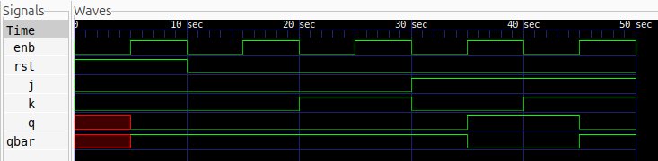

# JK Latch

## Description
A JK Latch is a level-sensitive sequential circuit that stores one bit of data. It is an improved version of the SR latch that eliminates the invalid input combination. The circuit has two control inputs, J and K, an enable input, and complementary outputs Q and Q̅. An additional reset input is included in this implementation.

## Logic
The operation of the JK Latch depends on the enable, reset, and J-K inputs. When the enable is LOW, the latch retains its previous state. When the reset is HIGH, the output is cleared. Otherwise, the J and K inputs determine whether the output holds, resets, sets, or toggles.

| ENB | RST | J | K | Q (Next State) | Operation |
|:---:|:---:|:---:|:---:|:---:|---|
| X | 1 | X | X | 0 | Reset |
| 0 | 0 | X | X | Q | Hold |
| 1 | 0 | 0 | 0 | Q | Hold |
| 1 | 0 | 0 | 1 | 0 | Reset |
| 1 | 0 | 1 | 0 | 1 | Set |
| 1 | 0 | 1 | 1 | Q̅ | Toggle |

Here, X represents a don't-care condition, and Q represents the current output state.

## Schematic
The logic schematic can be generated using Yosys and Graphviz.


## Files
- `jk_latch.v` — Verilog module implementing the JK latch.
- `jk_latch_tb.v` — Testbench for verifying the latch operation.
- `jk_latch.vcd` — Simulation waveform data.
- `jk_latch.png` — Logic schematic generated using Yosys.

## Simulation Waveform
The simulation waveform can be viewed using GTKWave.



## Tools
- Verilog HDL
- Icarus Verilog
- GTKWave
- Yosys

## Simulation

Compile the design and testbench:

```bash
iverilog -o jk_latch_sim jk_latch.v jk_latch_tb.v
```

Run the simulation:

```bash
vvp jk_latch_sim
```

Open the waveform:

```bash
gtkwave jk_latch.vcd
```
