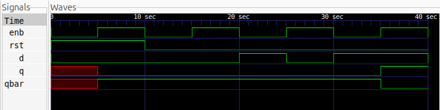

# D Latch

## Description
A D (Data) Latch is a level-sensitive sequential circuit that stores one bit of data. It has a data input (D), an enable input (ENB), a reset input (RST), and two complementary outputs (Q and Qbar). When enabled, the output follows the data input. When disabled, the latch retains its previous state.

## Logic
The behavior of the D Latch depends on the enable, reset, and data inputs. The reset input has priority over the enable input.

| ENB | RST | D | Q (Next State) | Operation |
|:---:|:---:|:---:|:---:|---|
| X | 1 | X | 0 | Reset |
| 0 | 0 | X | Q | Hold |
| 1 | 0 | 0 | 0 | Store 0 |
| 1 | 0 | 1 | 1 | Store 1 |

Here, X represents a don't-care condition, and Q represents the current output state.

## Schematic
The logic schematic can be generated using Yosys.


## Files
- `d_latch.v` — Verilog module implementing the D Latch.
- `d_latch_tb.v` — Testbench for verifying all input conditions.
- `d_latch.vcd` — Simulation waveform data.
- `d_latch.svg` — Logic schematic generated using Yosys.
- `waveform.png` — Simulation waveform screenshot.

## Simulation Waveform
The simulation waveform can be viewed using GTKWave.



## Tools
- Verilog HDL
- Icarus Verilog
- GTKWave
- Yosys

## Simulation

Compile the design and testbench:

```bash
iverilog -o d_latch_sim d_latch.v d_latch_tb.v
```

Run the simulation:

```bash
vvp d_latch_sim
```

Open the waveform:

```bash
gtkwave d_latch.vcd
```
