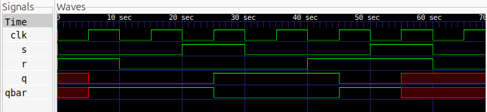

# SR Flip-Flop Design

## Description
This project implements a positive-edge-triggered SR (Set-Reset) Flip-Flop using Verilog HDL. The flip-flop is a synchronous sequential circuit that stores one bit of information and updates its output only at the rising edge of the clock.

## Logic
The SR Flip-Flop operates based on the Set (S) and Reset (R) inputs. Its output changes only on the positive edge of the clock.

### Truth Table

| Clock | S | R | Q(next) | Operation |
|:---:|:---:|:---:|:---:|:---:|
| ↑ | 0 | 0 | Q(previous) | Hold |
| ↑ | 0 | 1 | 0 | Reset |
| ↑ | 1 | 0 | 1 | Set |
| ↑ | 1 | 1 | Invalid | Forbidden |
| No Edge | X | X | Q(previous) | Hold |

**Note:** The condition S = R = 1 is forbidden because it produces an invalid state.

## Logic Schematic


## Files
- `sr_flip_flop.v` – Verilog implementation of the SR Flip-Flop.
- `sr_flip_flop_tb.v` – Testbench for functional verification.
- `sr_flip_flop.vcd` – Simulation waveform dump.
- `sr_flip_flop.svg` - Logic Schematic
- `waveform.png` - Testbench waveform

## Simulation Waveform



## Tools
- Verilog HDL
- Icarus Verilog – Simulation
- GTKWave – Waveform Visualization
- Yosys – Logic Synthesis and Schematic Generation

## Simulation Commands

Compile the Verilog files:

```bash
iverilog -o sr_flip_flop sr_flip_flop.v sr_flip_flop_tb.v
```

Run the simulation:

```bash
vvp sr_flip_flop
```

View the waveform:

```bash
gtkwave sr_flip_flop.vcd
```
