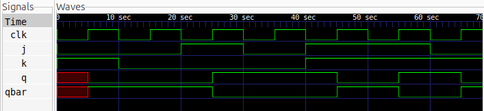

# JK Flip-Flop Design

## Description
This project implements a positive-edge-triggered JK (Jack-Kilby) Flip-Flop using Verilog HDL. It is a synchronous sequential circuit capable of storing one bit of information. Unlike the SR Flip-Flop, the JK Flip-Flop eliminates the forbidden input condition by introducing a toggle operation.

## Logic
The JK Flip-Flop operates based on two inputs, J and K. Its output changes only at the rising edge of the clock.

### Truth Table

| Clock | J | K | Q(next) | Operation |
|:---:|:---:|:---:|:---:|:---|
| ↑ | 0 | 0 | Q(previous) | Hold |
| ↑ | 0 | 1 | 0 | Reset |
| ↑ | 1 | 0 | 1 | Set |
| ↑ | 1 | 1 | Q̅(previous) | Toggle |

## Logic Schematic


## Files
- `jk_ff.v` – Verilog implementation of the JK Flip-Flop.
- `jk_ff_tb.v` – Testbench for functional verification.
- `jk_ff.vcd` – Simulation waveform dump.

## Simulation Waveform



## Tools
- Verilog HDL
- Icarus Verilog – Simulation
- GTKWave – Waveform Visualization
- Yosys – Logic Synthesis and Schematic Generation

## Simulation Commands

Compile the Verilog files:

```bash
iverilog -o jk_ff_sim jk_ff.v jk_ff_tb.v
```

Run the simulation:

```bash
vvp jk_ff
```

View the waveform:

```bash
gtkwave jk_ff.vcd
```
