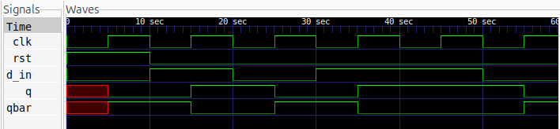

# D Flip-Flop Design

## Description
A D Flip-Flop (Data Flip-Flop) is a positive-edge-triggered sequential logic circuit that stores a single bit of data. The output follows the input `D` only at the rising edge of the clock signal and retains its previous state between clock edges.

This design implements a positive-edge-triggered D Flip-Flop with an synchronous active-high reset.

## Logic
The flip-flop updates its output on the rising edge of the clock.

- When `rst = 1`, the output `Q` is immediately reset to `0`.
- When `rst = 0`, the input `D` is transferred to `Q` at the rising edge of the clock.
- The complementary output `Q̅` is obtained by inverting `Q`.

### Truth Table

| Reset | Clock | D | Q(next) | Q̅(next) |
|:---:|:---:|:---:|:---:|:---:|
| 1 | ↑ | X | 0 | 1 |
| 0 | ↑ | 0 | 0 | 1 |
| 0 | ↑ | 1 | 1 | 0 |
| 0 | No edge | X | Q(previous) | Q̅(previous) |

## Logic Schematic


## Files
- `d_ff.v` – Verilog implementation of the D Flip-Flop.
- `d_ff_tb.v` – Testbench for functional verification.

## Simulation Waveform

The simulation waveform demonstrates the behaviour of the D Flip-Flop, showing how the output changes only at the rising edge of the clock



## Tools
- Verilog HDL
- Icarus Verilog
- GTKWave

## Simulation Commands

Compile the Verilog files:

```bash
iverilog -o d_ff d_ff.v d_ff_tb.v
```

Run the simulation:

```bash
vvp d_ff
```

View the waveform:

```bash
gtkwave d_ff.vcd
```
