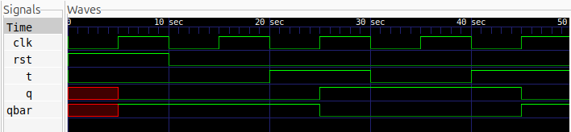

# T Flip-Flop Design

## Description
A T Flip-Flop (Toggle Flip-Flop) is a positive-edge-triggered sequential logic circuit that stores a single bit of data. It toggles its output whenever the input `T` is HIGH at the rising edge of the clock and retains its previous state when `T` is LOW.

This design implements a positive-edge-triggered T Flip-Flop with a synchronous active-high reset.

## Logic

The flip-flop operates according to the following conditions:

- When `rst = 1`, the output `Q` is synchronously reset to `0`.
- When `rst = 0` and `T = 0`, the output retains its previous state.
- When `rst = 0` and `T = 1`, the output toggles at every rising edge of the clock.
- The complementary output `Q̅` is obtained by inverting `Q`.

### Truth Table

| Reset | T | Q(next) | Operation |
|:---:|:---:|:---:|:---|
| 1 | X | 0 | Reset |
| 0 | 0 | Q(previous) | Hold |
| 0 | 1 | Q̅(previous) | Toggle |

### Characteristic Equation

\[
Q_{next} = T \oplus Q
\]

## Logic Schematic


## Files

- `t_ff.v` – Verilog implementation of the T Flip-Flop.
- `t_ff_tb.v` – Testbench for functional verification.

## Simulation Waveform

The simulation waveform demonstrates the toggling behaviour of the T Flip-Flop. It shows how the output changes at every rising edge of the clock when `T` is HIGH and retains its previous state when `T` is LOW.



## Tools

- Verilog HDL
- Icarus Verilog
- GTKWave

## Simulation Commands

Compile the Verilog files:

```bash
iverilog -o t_ff_sim t_ff.v t_ff_tb.v
```

Run the simulation:

```bash
vvp t_ff_sim
```

View the waveform:

```bash
gtkwave t_ff.vcd
```
