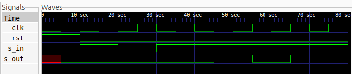

# 4-bit SISO Shift Register

## Description
A 4-bit Serial-In Serial-Out (SISO) Shift Register designed using Verilog HDL. The circuit accepts data serially from the MSB (front) and shifts it towards the LSB on every positive edge of the clock. The output is obtained serially from the LSB.

The design incorporates a synchronous active-high reset to initialize the register to `0000`.

## Logic

The shift register consists of four cascaded D Flip-Flops. On every positive clock edge, the incoming serial bit enters the MSB, while the existing bits shift one position towards the LSB.

The output is taken from the LSB of the register.

## Logic Schematic

## Files

- `siso.v` – Verilog RTL design.
- `siso_tb.v` – Verilog testbench.
- `siso.svg` - Schematic
- `waveform.png` - Output testbench

## Simulation Waveform

## Tools

- Verilog HDL
- Icarus Verilog
- GTKWave
- Yosys
