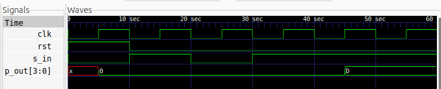

# 4-bit SIPO Shift Register

## Description
A 4-bit Serial-In Parallel-Out (SIPO) Shift Register designed using Verilog HDL. The circuit receives data serially, one bit at a time, and provides a 4-bit parallel output after all four input bits have been received.

The design uses a synchronous active-high reset and a counter to track the number of received bits. The parallel output remains `0000` until the complete 4-bit data sequence is received.

## Logic

The shift register consists of four cascaded D Flip-Flops. Serial data enters from the MSB (front) and shifts towards the LSB on every positive edge of the clock.

Once four bits have been received, the parallel output is enabled. The received data is held until the next reset.

## Logic Schematic

## Files

- `sipo.v` – Verilog RTL design.
- `sipo_tb.v` – Verilog testbench.

## Simulation Waveform

## Tools

- Verilog HDL
- Icarus Verilog
- GTKWave
- Yosys
