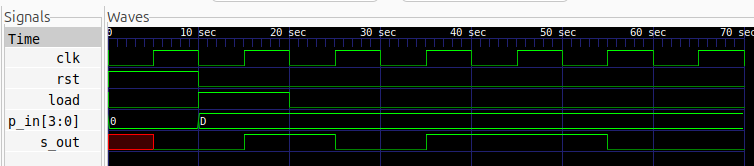

# 4-bit PISO Shift Register

## Description
A 4-bit Parallel-In Serial-Out (PISO) Shift Register designed using Verilog HDL. The circuit accepts 4-bit data simultaneously through parallel inputs and transmits it serially, one bit at a time.

The design uses a synchronous active-high reset and a load control signal. When `load` is asserted, all four input bits are loaded into the register simultaneously. When `load` is deasserted, the stored data shifts towards the LSB on every positive edge of the clock.

The serial output is taken from the LSB, resulting in **LSB-first transmission**.

## Logic

The shift register consists of four cascaded D Flip-Flops with parallel loading capability.

It supports three operating conditions:

- **Reset:** Clears the register to `0000`.
- **Parallel Load:** Loads the 4-bit input into the register.
- **Serial Shift:** Shifts the stored data towards the LSB.

## Logic Schematic

## Files

- `piso.v` – Verilog RTL design.
- `piso_tb.v` – Verilog testbench.

## Simulation Waveform

## Tools

- Verilog HDL
- Icarus Verilog
- GTKWave
- Yosys
