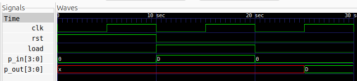

# 4-bit PIPO Register

## Description
A 4-bit Parallel-In Parallel-Out (PIPO) Register designed using Verilog HDL. The circuit accepts 4-bit data simultaneously through parallel inputs and stores it in a register. The stored data is available simultaneously at the parallel outputs.

The design uses a synchronous active-high reset and a load control signal. When `load` is asserted, the input data is loaded into the register on the positive edge of the clock. When `load` is deasserted, the register retains its previously stored data.

## Logic

The PIPO register consists of four D Flip-Flops with a common clock, reset, and load control.

It supports three operating conditions:

- **Reset:** Clears the register to `0000`.
- **Parallel Load:** Loads the 4-bit input into the register simultaneously.
- **Hold:** Retains the previously stored data when `load` is deasserted.

## Logic Schematic

## Files

- `pipo.v` – Verilog RTL design.
- `pipo_tb.v` – Verilog testbench.

## Simulation Waveform

## Tools

- Verilog HDL
- Icarus Verilog
- GTKWave
- Yosys
