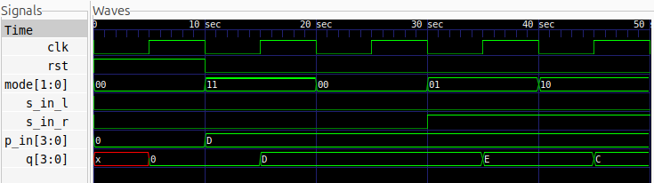

# Universal Shift Register (4-bit)

## Description
A 4-bit Universal Shift Register implemented in Verilog HDL using behavioral modelling. It supports four fundamental operations: Hold, Shift Right, Shift Left, and Parallel Load. The operation is selected using a 2-bit mode control input.

## Logic
The operation of the register is controlled by the `mode[1:0]` input.

| Mode | Operation | Description |
|:---:|---|---|
| 00 | Hold | Retains the previous register value |
| 01 | Shift Right | Shifts data one position to the right |
| 10 | Shift Left | Shifts data one position to the left |
| 11 | Parallel Load | Loads all four input bits simultaneously |

The register uses a positive-edge-triggered clock and synchronous active-high reset.

## Inputs and Outputs

| Signal | Description |
|---|---|
| `clk` | Clock input |
| `rst` | Synchronous active-high reset |
| `mode[1:0]` | Operation selection |
| `s_in_left` | Serial input for left shift |
| `s_in_right` | Serial input for right shift |
| `p_in[3:0]` | 4-bit parallel input |
| `q[3:0]` | 4-bit register output |

## Logic Schematic

## Files
- `usr.v` – Verilog module implementing the 4-bit Universal Shift Register.
- `usr_tb.v` – Testbench for verifying all four operating modes.

## Simulation Waveform

## Tools
- Verilog HDL
- Icarus Verilog
- GTKWave
- Yosys
