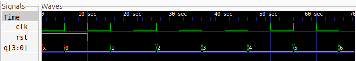

# 4-bit Synchronous Up Counter

## Description
A 4-bit Synchronous Up Counter implemented in Verilog HDL using behavioral modelling. The counter increments its value by one on every positive edge of the clock signal. It counts from 0 to 15 and automatically rolls over to 0. A synchronous active-high reset is used to initialize the counter.

## Logic
All four flip-flops share a common clock signal and update simultaneously on every rising edge.

When reset is activated, the counter is cleared to `0000`. Otherwise, the counter increments by one.

### Counting Sequence

| Clock Pulse | Q[3:0] | Decimal |
|:---:|:---:|:---:|
| 0 | 0000 | 0 |
| 1 | 0001 | 1 |
| 2 | 0010 | 2 |
| 3 | 0011 | 3 |
| 4 | 0100 | 4 |
| 5 | 0101 | 5 |
| 6 | 0110 | 6 |
| 7 | 0111 | 7 |
| 8 | 1000 | 8 |
| ... | ... | ... |
| 15 | 1111 | 15 |
| 16 | 0000 | 0 |

## Logic Schematic

## Files
- `sync_up_counter.v` – Verilog module implementing the 4-bit synchronous up counter.
- `sync_up_counter_tb.v` – Testbench for verifying the counting sequence and reset operation.

## Simulation Waveform

## Tools
- Verilog HDL
- Icarus Verilog
- GTKWave
- Yosys
