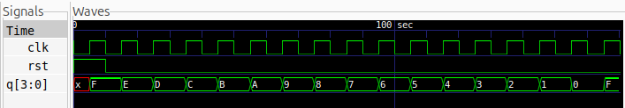

# 4-bit Synchronous Down Counter

## Description
A 4-bit Synchronous Down Counter implemented in Verilog HDL using behavioral modelling. The counter decrements its value by one on every positive edge of the clock signal. It counts from 15 to 0 and automatically rolls over to 15. A synchronous active-high reset initializes the counter to `1111`.

## Logic
All four flip-flops share a common clock signal and update simultaneously on every rising edge.

When reset is activated, the counter is initialized to `1111`. Otherwise, the counter decrements by one.

### Counting Sequence

| Clock Pulse | Q[3:0] | Decimal |
|:---:|:---:|:---:|
| 0 | 1111 | 15 |
| 1 | 1110 | 14 |
| 2 | 1101 | 13 |
| 3 | 1100 | 12 |
| 4 | 1011 | 11 |
| 5 | 1010 | 10 |
| 6 | 1001 | 9 |
| 7 | 1000 | 8 |
| 8 | 0111 | 7 |
| ... | ... | ... |
| 15 | 0000 | 0 |
| 16 | 1111 | 15 |

## Logic Schematic

## Files
- `sync_down_counter.v` – Verilog module implementing the 4-bit synchronous down counter.
- `sync_down_counter_tb.v` – Testbench for verifying the counting sequence and reset operation.

## Simulation Waveform

## Tools
- Verilog HDL
- Icarus Verilog
- GTKWave
- Yosys
