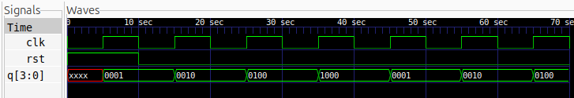

# 4-Bit Ring Counter

## Description
A 4-bit Ring Counter implemented using Verilog HDL. It is a circular shift register consisting of four D flip-flops, where the output of the last flip-flop is fed back to the input of the first flip-flop.

The counter cycles through four distinct states, with a single HIGH bit circulating through the register on every positive clock edge.

## Logic
The Ring Counter operates by circularly shifting its 4-bit register to the left on every positive edge of the clock.

- When reset is HIGH, the register is initialized to `0001`.
- When reset is LOW, the stored bit pattern rotates by one position.
- The output of the most significant bit is fed back to the least significant bit.

**State Sequence:**

| Clock Cycle | q[3] | q[2] | q[1] | q[0] |
|:---:|:---:|:---:|:---:|:---:|
| Initial | 0 | 0 | 0 | 1 |
| 1 | 0 | 0 | 1 | 0 |
| 2 | 0 | 1 | 0 | 0 |
| 3 | 1 | 0 | 0 | 0 |
| 4 | 0 | 0 | 0 | 1 |

The sequence repeats after every four clock cycles.

## Logic Schematic

## Files
- `ring_counter.v` – Verilog design of the 4-bit Ring Counter.
- `ring_counter_tb.v` – Testbench for functional verification.

## Simulation Waveform

## Tools
- Verilog HDL
- Icarus Verilog
- GTKWave
- Yosys
