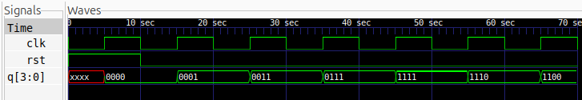

# 4-Bit Johnson Counter

## Description
A 4-bit Johnson Counter implemented using Verilog HDL. It is a synchronous sequential circuit consisting of four D flip-flops connected as a shift register, with the complemented output of the last flip-flop fed back to the input of the first flip-flop.

The counter generates eight distinct states before repeating its sequence.

## Logic
The Johnson Counter operates by shifting the stored bits towards the most significant bit on every positive edge of the clock.

- When reset is HIGH, the counter is initialized to `0000`.
- When reset is LOW, the register shifts its contents by one position.
- The complemented output of the most significant bit is fed back to the least significant bit.

**State Sequence:**

| Clock Cycle | q[3] | q[2] | q[1] | q[0] |
|:---:|:---:|:---:|:---:|:---:|
| Initial | 0 | 0 | 0 | 0 |
| 1 | 0 | 0 | 0 | 1 |
| 2 | 0 | 0 | 1 | 1 |
| 3 | 0 | 1 | 1 | 1 |
| 4 | 1 | 1 | 1 | 1 |
| 5 | 1 | 1 | 1 | 0 |
| 6 | 1 | 1 | 0 | 0 |
| 7 | 1 | 0 | 0 | 0 |
| 8 | 0 | 0 | 0 | 0 |

An n-bit Johnson Counter can generate up to 2n distinct states.

## Logic Schematic

## Files
- `johnson_counter.v` – Verilog design of the 4-bit Johnson Counter.
- `johnson_counter_tb.v` – Testbench for functional verification.

## Simulation Waveform

## Tools
- Verilog HDL
- Icarus Verilog
- GTKWave
- Yosys
