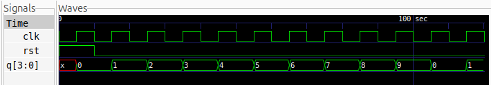

# 4-Bit MOD-10 Counter

## Description
A 4-bit MOD-10 Counter implemented using Verilog HDL. It is a synchronous sequential circuit that counts from 0 to 9 and then returns to 0.

Also known as a Decade Counter, it uses four flip-flops to represent ten distinct states. The counter uses synchronous reset and automatically restarts its counting sequence after reaching decimal 9.

## Logic
The counter increments its value by one on every positive edge of the clock.

- When reset is HIGH, the counter is initialized to `0000`.
- When the count reaches `1001` (decimal 9), it returns to `0000` on the next positive clock edge.
- Otherwise, the counter increments normally.

**State Sequence:**

| Clock Cycle | Decimal | Binary |
|:---:|:---:|:---:|
| Initial | 0 | 0000 |
| 1 | 1 | 0001 |
| 2 | 2 | 0010 |
| 3 | 3 | 0011 |
| 4 | 4 | 0100 |
| 5 | 5 | 0101 |
| 6 | 6 | 0110 |
| 7 | 7 | 0111 |
| 8 | 8 | 1000 |
| 9 | 9 | 1001 |
| 10 | 0 | 0000 |

The sequence repeats after every ten clock cycles.

## Logic Schematic

## Files
- `mod10_counter.v` – Verilog design of the 4-bit MOD-10 Counter.
- `mod10_counter_tb.v` – Testbench for functional verification.

## Simulation Waveform

## Tools
- Verilog HDL
- Icarus Verilog
- GTKWave
- Yosys
